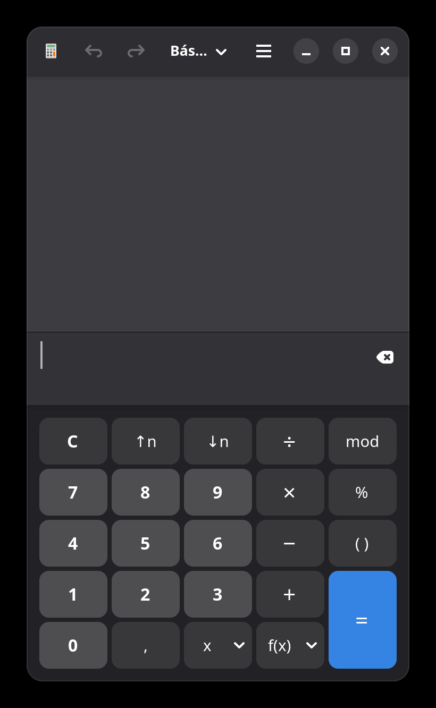
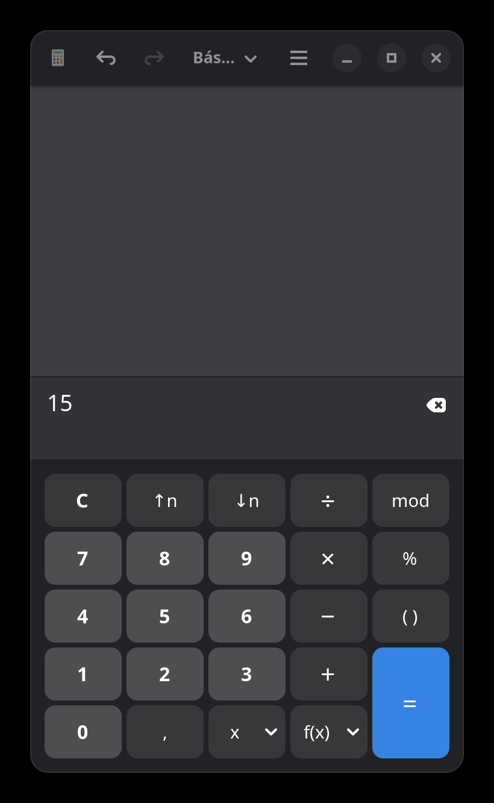
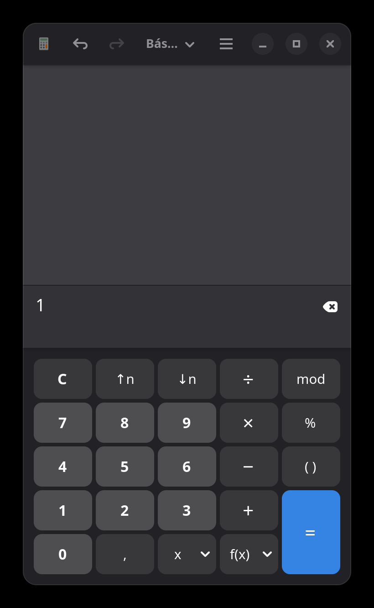
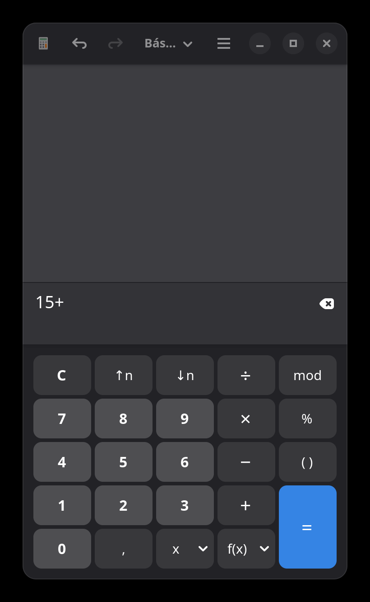
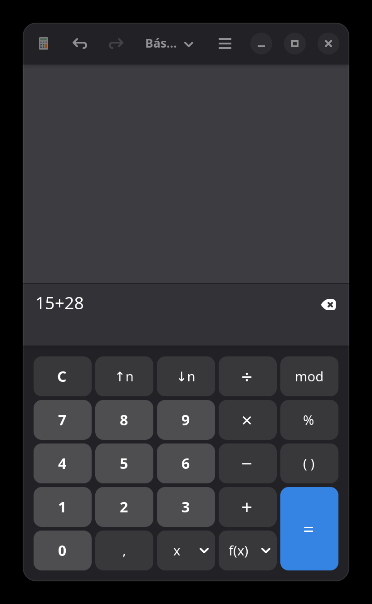
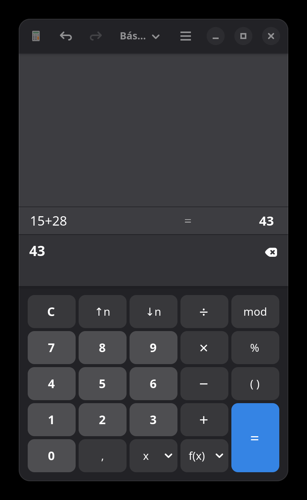

# Manual de Usuario — Función Suma en Calculadora de GNOME

| Campo | Valor |
|-------|-------|
| **Aplicación** | GNOME Calculator |
| **Versión** | 50.0 |
| **Sistema operativo** | Linux (GNOME) |
| **Módulo** | Suma (modo Básico) |
| **Fecha** | 14 de octubre de 2026 |

---

## Índice

- [1. Propósito](#1-propósito)
- [2. Público objetivo](#2-público-objetivo)
- [3. Alcance](#3-alcance)
- [4. Requisitos](#4-requisitos)
- [5. Descripción de la interfaz](#5-descripción-de-la-interfaz)
- [6. Procedimiento: realizar una suma](#6-procedimiento-realizar-una-suma)
  - [6.1. Abrir la calculadora](#61-abrir-la-calculadora)
  - [6.2. Ingresar el primer número](#62-ingresar-el-primer-número)
  - [6.3. Seleccionar la operación de suma](#63-seleccionar-la-operación-de-suma)
  - [6.4. Ingresar el segundo número](#64-ingresar-el-segundo-número)
  - [6.5. Obtener el resultado](#65-obtener-el-resultados)
- [7. Ejemplo completo: 15 + 28 = 43](#7-ejemplo-completo-15--28--43)
- [8. Resolución de problemas](#8-resolución-de-problemas)
- [9. Notas y referencias](#9-notas-y-referencias)

---

## 1. Propósito

Este manual explica paso a paso cómo utilizar la función de **suma** en la aplicación **Calculadora de GNOME** (versión 50.0), en su modo **Básico**. El objetivo es permitir a cualquier persona realizar sumas simples de dos o más números enteros o decimales.

## 2. Público objetivo

Personas usuarias sin conocimientos técnicos avanzados que necesiten realizar operaciones aritméticas básicas en un entorno de escritorio GNOME.

## 3. Alcance

Este documento cubre exclusivamente la operación de **suma** en el **modo Básico** de la calculadora. No se incluyen otros modos (Scientific, Financial, Programming, Templates), otras operaciones (resta, multiplicación, división) ni funciones avanzadas.

## 4. Requisitos

- Sistema operativo Linux con escritorio GNOME (o compatible).
- Aplicación **GNOME Calculator** instalada (versión 50.0 verificada en este manual).
- Permisos de Accessibilidad y Screen Recording para la herramienta de automatización utilizada durante la verificación.

### 4.1. Cómo abrir la calculadora

La aplicación puede iniciarse de varias formas:

- **Desde la terminal:** ejecutar el comando `gnome-calculator`.
- **Desde el menú de aplicaciones:** buscar "Calculadora" o "Calculator" en el lanzador de aplicaciones de GNOME.

> **Nota:** Durante la verificación de este manual, la aplicación se lanzó desde la terminal con el comando `gnome-calculator &`.

## 5. Descripción de la interfaz

Al abrir la calculadora en modo Básico, la interfaz presenta las siguientes zonas:

### 5.1. Barra superior

| Elemento | Descripción |
|----------|-------------|
| **Icono de calculadora** | Identificador visual de la aplicación. |
| **Flechas Deshacer / Rehacer** | Permiten revertir o restaurar la última acción. |
| **Selector de modo** | Muestra el modo actual (ej. "Bás..." abreviatura de "Básico"). Permite cambiar entre modos. |
| **Menú principal** | Botón con tres líneas horizontales (icono hamburguesa). Accede a opciones adicionales de la aplicación. |
| **Controles de ventana** | Minimizar, Maximizar y Cerrar. |

### 5.2. Área de visualización

| Elemento | Descripción |
|----------|-------------|
| **Display principal** | Zona gris superior que muestra el resultado y el historial de la operación. |
| **Campo de entrada** | Barra oscura debajo del display que muestra la expresión actual (números y operadores ingresados). A la derecha incluye un botón de borrado (icono de retroceso). |

### 5.3. Teclado numérico

El teclado se organiza en una cuadrícula de botones:

| Fila | Botones |
|------|---------|
| **Fila 1** | `C` (Borrar todo), `↑n`, `↓n`, `÷` (dividir), `mod` |
| **Fila 2** | `7`, `8`, `9`, `×` (multiplicar), `%` (porcentaje) |
| **Fila 3** | `4`, `5`, `6`, `−` (restar), `( )` (paréntesis) |
| **Fila 4** | `1`, `2`, `3`, `+` (sumar) |
| **Fila 5** | `0`, `,` (coma decimal), `x` (variable), `f(x)` (funciones) |
| **Columna derecha** | `=` (igual) — botón azul grande que ocupa dos filas de altura. |

*Figura 1: Teclado numérico de la Calculadora de GNOME en modo Básico.*

## 6. Procedimiento: realizar una suma

A continuación se detalla el procedimiento paso a paso para sumar dos números.

### 6.1. Abrir la calculadora

1. Inicie la aplicación (ver sección 4.1).
2. Verifique que el selector de modo en la barra superior muestre "**Básico**" o "**Bás...**".
3. Confirme que el campo de entrada esté vacío o presione el botón **`C`** para reiniciar.

*Figura 2: Calculadora con el campo de entrada vacío.*

### 6.2. Ingresar el primer número

1. Pulse los botones numéricos correspondientes al primer número que desea sumar.
2. Los dígitos aparecerán en el campo de entrada, de izquierda a derecha.

> **Ejemplo:** Para ingresar el número 15, pulse primero `1` y luego `5`. El campo de entrada mostrará **`15`**.

*Figura 3: Primer número (15) ingresado en el campo de entrada.*

### 6.3. Seleccionar la operación de suma

1. Pulse el botón **`+`** (suma), ubicado en la cuarta fila del teclado, en la columna de operadores (tercera columna desde la derecha).
2. El símbolo `+` se añadirá al campo de entrada, justo después del primer número.

> **Verificación:** El campo de entrada debe mostrar el primer número seguido del símbolo `+` (ej. `15+`).

*Figura 4: Operador de suma seleccionado. El campo muestra `15+`.*

### 6.4. Ingresar el segundo número

1. Pulse los botones numéricos correspondientes al segundo número.
2. Los dígitos se añadirán a la expresión en el campo de entrada.

> **Ejemplo:** Para sumar 28, pulse `2` y luego `8`. El campo de entrada mostrará **`15+28`**.

*Figura 5: Segundo número (28) ingresado. La expresión completa es `15+28`.*

### 6.5. Obtener el resultado

1. Pulse el botón **`=`** (igual), el botón azul grande ubicado en la esquina inferior derecha del teclado.
2. El resultado de la operación aparecerá en el **display principal** (zona superior gris).
3. El campo de entrada mostrará el resultado calculado.

> **Verificación:** En el ejemplo 15 + 28, el display principal muestra `15+28 = 43` y el campo de entrada muestra `43`.

*Figura 6: Resultado de la operación. El display muestra `15+28 = 43`.*

## 7. Ejemplo completo: 15 + 28 = 43

A continuación se resume el flujo completo en una sola tabla:

| Paso | Acción | Campo de entrada | Display principal |
|------|--------|------------------|-------------------|
| 1 | Abrir calculadora | *(vacío)* | *(vacío)* |
| 2 | Pulsar `1` | `1` | *(vacío)* |
| 3 | Pulsar `5` | `15` | *(vacío)* |
| 4 | Pulsar `+` | `15+` | *(vacío)* |
| 5 | Pulsar `2` | `15+2` | *(vacío)* |
| 6 | Pulsar `8` | `15+28` | *(vacío)* |
| 7 | Pulsar `=` | `43` | `15+28 = 43` |

### 7.1. Sumas encadenadas

La calculadora permite realizar sumas consecutivas sin presionar `=` intermedios:

1. Ingrese el primer número (ej. `10`).
2. Pulse `+`.
3. Ingrese el segundo número (ej. `20`).
4. Pulse `+` nuevamente.
5. Ingrese el tercer número (ej. `5`).
6. Pulse `=`.

El resultado será **35**.

## 8. Resolución de problemas

| Problema | Causa posible | Solución |
|----------|---------------|----------|
| La calculadora no se abre | La aplicación no está instalada o el proceso falló. | Verifique la instalación con `gnome-calculator --version` en la terminal. |
| El campo de entrada no muestra los dígitos | La entrega de interacción no se confirmó. | Intente hacer clic directamente en los botones numéricos. |
| El resultado no es correcto | Error de digitación o operador incorrecto. | Pulse el botón **`C`** para reiniciar y repita la operación. |
| No se visualiza el resultado | El display principal está oculto o la ventana necesita redimensionarse. | Redimensione la ventana de la calculadora o pulse el botón **Maximizar**. |
| Desea deshacer un error | Pulsó un dígito u operador incorrecto. | Use la flecha **Deshacer** en la barra superior para revertir el último paso. |

## 9. Notas y referencias

- Este manual fue elaborado con base en observaciones verificadas directamente sobre la aplicación **GNOME Calculator 50.0** ejecutándose en un entorno Linux con escritorio GNOME.
- Todos los pasos, nombres de botones y resultados fueron confirmados mediante captura de estado de la interfaz antes y después de cada acción.
- Las capturas de pantalla se encuentran en la carpeta `recursos/` junto a este documento.
- La aplicación es de código abierto y forma parte del proyecto GNOME. Más información en [gitlab.gnome.org/GNOME/gnome-calculator](https://gitlab.gnome.org/GNOME/gnome-calculator).

---

*Fin del documento.*
